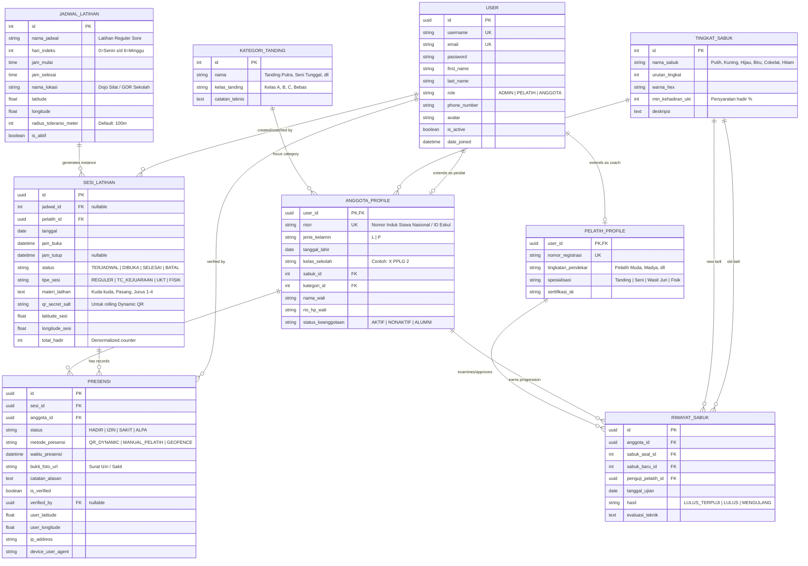

# Entity Relationship Diagram (ERD) & Data Dictionary
## SilatTrack: Sistem Absensi Eskul Pencak Silat

- **Dokumen**: Spesifikasi Model Data Relasional & Django ORM
- **Database Engine**: PostgreSQL / SQLite 3 (Production-ready Django Models)
- **Status**: Complete & Normalized (3NF)

---

## 1. Visual Entity Relationship Diagram (Mermaid)

---

## 2. Kamus Data & Spesifikasi Kolom (Data Dictionary)

### 2.1 Entitas: `User` (`accounts_user`)
Meng-inherit `AbstractUser` bawaan Django untuk integrasi otentikasi standar industri.

| Nama Kolom | Tipe Data | Constraint | Keterangan |
| :--- | :--- | :--- | :--- |
| `id` | UUID | PK, Auto | Pengidentifikasi unik global |
| `username` | VARCHAR(150) | Unique, Not Null | Digunakan untuk login (bisa NISN/No Induk) |
| `email` | VARCHAR(254) | Nullable, Indexed | Email pengguna untuk reset password & notifikasi |
| `password` | VARCHAR(128) | Not Null | Hashed password (Argon2 / PBKDF2) |
| `first_name` | VARCHAR(150) | Not Null | Nama depan |
| `last_name` | VARCHAR(150) | Blank | Nama belakang |
| `role` | VARCHAR(20) | Choices, Default: 'ANGGOTA' | Choices: `ADMIN`, `PELATIH`, `ANGGOTA` |
| `phone_number` | VARCHAR(20) | Nullable | Nomor WhatsApp aktif untuk kontak darurat |
| `avatar` | VARCHAR(255) / ImageField | Nullable | Path foto profil pengguna |
| `is_active` | BOOLEAN | Default: True | Status aktivasi akun |
| `date_joined` | DATETIME | Default: Now | Waktu pendaftaran |

---

### 2.2 Entitas: `TingkatSabuk` (`core_tingkatsabuk`)
Master data tingkatan sabuk dalam pencak silat.

| Nama Kolom | Tipe Data | Constraint | Keterangan |
| :--- | :--- | :--- | :--- |
| `id` | SMALLINT | PK, Auto | ID tingkatan |
| `nama_sabuk` | VARCHAR(50) | Not Null, Unique | Misal: "Putih", "Kuning", "Hijau", "Biru", "Cokelat", "Hitam" |
| `urutan_tingkat` | SMALLINT | Not Null, Indexed | Urutan hierarki (1 = terendah / pemula) |
| `warna_hex` | VARCHAR(7) | Not Null | Kode warna HEX untuk badge UI (misal `#FBBF24`) |
| `min_kehadiran_ukt`| SMALLINT | Default: 75 | Persentase minimal kehadiran untuk ikut UKT (%) |
| `deskripsi` | TEXT | Nullable | Filosofi atau kurikulum dasar pada sabuk tersebut |

---

### 2.3 Entitas: `AnggotaProfile` (`members_anggotaprofile`)
Detail informasi pesilat yang terhubung 1-to-1 dengan User.

| Nama Kolom | Tipe Data | Constraint | Keterangan |
| :--- | :--- | :--- | :--- |
| `user_id` | UUID | PK, FK (`User.id`), OneToOne | Relasi ke tabel User utama |
| `nisn` | VARCHAR(20) | Unique, Indexed | Nomor Induk Siswa Nasional / ID Anggota Silat |
| `jenis_kelamin` | CHAR(1) | Choices (`L`, `P`) | Laki-laki / Perempuan |
| `tanggal_lahir` | DATE | Nullable | Tanggal lahir untuk pengelompokan usia tanding |
| `kelas_sekolah` | VARCHAR(50) | Not Null | Kelas & Jurusan di sekolah (misal: "X TJKT 1") |
| `sabuk_id` | SMALLINT | FK (`TingkatSabuk.id`) | Sabuk yang saat ini disandang |
| `kategori_id` | INT | FK (`KategoriTanding.id`), Nullable | Kategori peminatan (Tanding/Seni) |
| `nama_wali` | VARCHAR(100) | Nullable | Nama orang tua / wali murid |
| `no_hp_wali` | VARCHAR(20) | Nullable | Nomor kontak darurat wali murid |
| `status_keanggotaan` | VARCHAR(20) | Default: 'AKTIF' | Choices: `AKTIF`, `NONAKTIF`, `ALUMNI` |

---

### 2.4 Entitas: `JadwalLatihan` (`schedule_jadwallatihan`)
Master template jadwal latihan mingguan.

| Nama Kolom | Tipe Data | Constraint | Keterangan |
| :--- | :--- | :--- | :--- |
| `id` | INT | PK, Auto | ID jadwal |
| `nama_jadwal` | VARCHAR(100) | Not Null | Misal: "Latihan Wajib Selasa Sore" |
| `hari_indeks` | SMALLINT | Choices (0-6) | 0 = Senin, 1 = Selasa ... 6 = Minggu |
| `jam_mulai` | TIME | Not Null | Waktu mulai latihan (misal: 15:30:00) |
| `jam_selesai` | TIME | Not Null | Waktu selesai latihan (misal: 17:30:00) |
| `nama_lokasi` | VARCHAR(150) | Not Null | Nama fisik tempat (e.g. "Lapangan Tenis Indoor") |
| `latitude` | DECIMAL(10, 8) | Nullable | Titik koordinat garis lintang geofence |
| `longitude` | DECIMAL(11, 8) | Nullable | Titik koordinat garis bujur geofence |
| `radius_toleransi_meter`| INT | Default: 100 | Toleransi jarak absensi (meter) |
| `is_aktif` | BOOLEAN | Default: True | Toggle status aktif jadwal |

---

### 2.5 Entitas: `SesiLatihan` (`attendance_sesilatihan`)
Sesi latihan konkret pada tanggal tertentu yang dibuka oleh pelatih.

| Nama Kolom | Tipe Data | Constraint | Keterangan |
| :--- | :--- | :--- | :--- |
| `id` | UUID | PK, Default: UUIDv4 | ID unik sesi latihan |
| `jadwal_id` | INT | FK (`JadwalLatihan.id`), Nullable | Mengacu ke jadwal rutin atau ad-hoc |
| `pelatih_id` | UUID | FK (`User.id`), Not Null | Pelatih yang memimpin & bertanggung jawab |
| `tanggal` | DATE | Not Null, Indexed | Tanggal pelaksanaan latihan |
| `jam_buka` | DATETIME | Not Null | Waktu tepat sesi dibuka |
| `jam_tutup` | DATETIME | Nullable | Waktu tepat sesi ditutup |
| `status` | VARCHAR(20) | Choices, Default: 'DIBUKA' | Choices: `TERJADWAL`, `DIBUKA`, `SELESAI`, `BATAL` |
| `tipe_sesi` | VARCHAR(20) | Choices, Default: 'REGULER' | Choices: `REGULER`, `TC_KEJUARAAN`, `UKT`, `FISIK` |
| `materi_latihan` | TEXT | Blank | Catatan menu latihan harian |
| `qr_secret_salt` | VARCHAR(64) | Not Null | Rahasia unik untuk enkripsi HMAC Dynamic QR |
| `latitude_aktual` | DECIMAL(10,8) | Nullable | Lokasi aktual saat pelatih membuka sesi |
| `longitude_aktual`| DECIMAL(11,8) | Nullable | Lokasi aktual saat pelatih membuka sesi |
| `total_hadir` | INT | Default: 0 | Cached count jumlah yang hadir |

---

### 2.6 Entitas: `Presensi` (`attendance_presensi`)
Log pencatatan kehadiran anggota pada sesi latihan. Memiliki unique constraint pada `(sesi_id, anggota_id)`.

| Nama Kolom | Tipe Data | Constraint | Keterangan |
| :--- | :--- | :--- | :--- |
| `id` | UUID | PK, Default: UUIDv4 | ID unik record presensi |
| `sesi_id` | UUID | FK (`SesiLatihan.id`), Indexed | Sesi latihan yang dihadiri |
| `anggota_id` | UUID | FK (`AnggotaProfile.user_id`), Indexed| Anggota yang diabsen |
| `status` | VARCHAR(10) | Choices, Not Null | Choices: `HADIR`, `IZIN`, `SAKIT`, `ALPA` |
| `metode_presensi` | VARCHAR(20) | Choices, Default: 'QR_DYNAMIC' | Choices: `QR_DYNAMIC`, `MANUAL_PELATIH`, `GEOFENCE` |
| `waktu_presensi` | DATETIME | Default: Now, Indexed | Timestamp presensi tercatat |
| `bukti_foto_url` | VARCHAR(255) | Nullable | Foto surat dokter/keterangan ortu bila izin/sakit |
| `catatan_alasan` | TEXT | Blank | Alasan ketidakhadiran atau catatan pelatih |
| `is_verified` | BOOLEAN | Default: True | Terverifikasi oleh sistem/pelatih |
| `verified_by_id` | UUID | FK (`User.id`), Nullable | Pelatih yang mengkonfirmasi/mengubah status |
| `user_latitude` | DECIMAL(10,8) | Nullable | Lokasi GPS perangkat siswa saat scan QR |
| `user_longitude` | DECIMAL(11,8) | Nullable | Lokasi GPS perangkat siswa saat scan QR |
| `ip_address` | INET / VARCHAR(45) | Nullable | Alamat IP perangkat siswa |
| `device_user_agent`| VARCHAR(255) | Nullable | Identitas browser/perangkat siswa |

---

## 3. Indeks & Aturan Integritas Data (Constraints & Indexes)

1. **Unique Key Komposit**:
   - `UNIQUE (sesi_id, anggota_id)` pada tabel `Presensi`: Mencegah duplikasi absensi seorang pesilat di sesi yang sama.
2. **Compound Index**:
   - `INDEX idx_presensi_waktu_status (waktu_presensi, status)`: Mempercepat agregasi laporan bulanan dan perhitungan streak kehadiran.
   - `INDEX idx_sesi_tgl_status (tanggal, status)`: Mempercepat loading dashboard pelatih/admin.
3. **Cascade Rules**:
   - Penghapusan `User` akan me-trigger `CASCADE` ke `AnggotaProfile` / `PelatihProfile`.
   - Penghapusan `SesiLatihan` dibatasi (`PROTECT` atau `RESTRICT`) jika telah memiliki data `Presensi` untuk menjaga audit trail historis.
