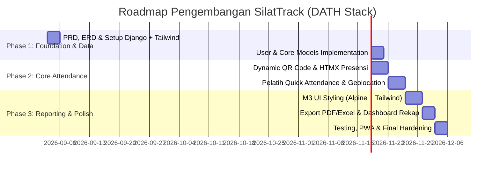

# Product Requirements Document (PRD)
## Aplikasi Absensi Ekstrakurikuler Pencak Silat

- **Nama Produk**: **SilatTrack** (Sistem Absensi & Manajemen Eskul Pencak Silat)
- **Tech Stack**: **DATH Stack** (Django + Alpine.js + Tailwind CSS + HTMX)
- **Arsitektur**: HTML-over-the-Wire / Modern Monolith
- **Design System**: Google Material Design 3 (M3)
- **Versi Dokumen**: 1.0.0
- **Status**: Ready for Implementation

---

## 1. Executive Summary & Visi Produk

Ekstrakurikuler Pencak Silat di institusi pendidikan (SD/SMP/SMA/Perguruan Tinggi) atau perguruan beladiri sering menghadapi kendala dalam pencatatan kehadiran:
1. Pencatatan manual berbasis kertas rentan hilang, rusak, atau dimanipulasi (titip absen).
2. Sulitnya memantau keaktifan siswa sebagai syarat kenaikan tingkat (sabuk) atau seleksi kejuaraan/tanding.
3. Lambatnya rekapitulasi data kehadiran untuk laporan ke pihak sekolah dan wali murid.

**SilatTrack** hadir sebagai solusi modern monolitik yang ringan, cepat, dan responsif (PWA-ready) berbasis **DATH Stack**. Aplikasi ini memanfaatkan paradigma **HTML-over-the-Wire** sehingga interaktif seperti SPA (Single Page Application) tanpa kerumitan frontend build yang berat, dibungkus dalam estetika antarmuka **Google Material Design 3 (M3)**.

---

## 2. User Personas & Roles

| Role | Deskripsi | Kebutuhan Utama |
| :--- | :--- | :--- |
| **Super Admin / Pembina Eskul** | Guru Pembina atau Penanggung Jawab dari pihak sekolah | Monitoring seluruh kegiatan, manajemen akun pelatih/anggota, export rekapitulasi nilai/kehadiran (PDF/Excel), evaluasi keaktifan eskul. |
| **Pelatih / Coach (Instruktur)** | Pelatih silat resmi perguruan | Buka/tutup sesi latihan, generate Dynamic QR Code presensi, input absensi manual/koreksi, input catatan materi latihan (Jurus, Fisik, Sambung/Tanding), validasi izin/sakit. |
| **Anggota / Pesilat (Siswa)** | Murid peserta ekstrakurikuler | Scan QR Code untuk check-in mandiri, mengajukan surat izin/sakit dengan bukti foto, memantau persentase kehadiran dan riwayat sabuk. |
| **Orang Tua / Wali Murid** *(Viewer/Public Status)* | Orang tua dari siswa | Notifikasi atau akses transparansi kehadiran anak dalam kegiatan ekstrakurikuler. |

---

## 3. Core Features & Functional Requirements

### 3.1 Manajemen Autentikasi & Pengguna (RBAC)
- **Multi-Role Login**: Admin, Pelatih, Anggota (menggunakan Django Authentication + Custom User Model).
- **Identitas Pesilat**: NISN/Nomor Anggota, Nama Lengkap, Tingkat Sabuk, Kategori Tanding (Tanding / Seni Tunggal, Ganda, Regu), Kelas/Jurusan.
- **Session Security**: HTMX CSRF protection header, token rotasi untuk sesi aktif.

### 3.2 Manajemen Jadwal & Sesi Latihan
- **Jadwal Rutin**: Pengaturan jadwal mingguan (misal: Selasa & Jumat 15:30 - 17:30 WIB).
- **Dynamic Sesi Latihan**: Pelatih membuat sesi latihan harian (Latihan Reguler, TC Kejuaraan, Ujian Kenaikan Tingkat).
- **Materi Latihan**: Pelatih mencatat materi yang diajarkan (misal: *Kuda-kuda, Pasang, Jurus Tunggal Baku 1-7, Fisik Sirkuit*).

### 3.3 Sistem Presensi Multi-Metode (Core Feature)
1. **Dynamic Rolling QR Code (Anti Titip Absen)**:
   - Pelatih menampilkan layar QR Code pada proyektor/HP pelatih.
   - QR Code di-generate dengan HMAC/Time-based Token yang berganti setiap 15-30 detik (menggunakan HTMX polling / Alpine timer).
   - Anggota scan menggunakan kamera smartphone tanpa perlu install aplikasi pihak ketiga (HTML5 WebCam Scanner via Alpine.js).
2. **Geofencing / Radius Toleransi (Opsional)**:
   - Validasi koordinat GPS perangkat siswa berada dalam radius lokasi latihan (misal: 100 meter dari Dojo/Lapangan).
3. **Pencatatan Cepat Manual (Quick Toggle Pelatih)**:
   - Interface pelatih menyediakan daftar anggota dengan switch HTMX toggle cepat (Hadir, Izin, Sakit, Alpa) dengan feedback visual instan.
4. **Pengajuan Izin & Sakit**:
   - Siswa dapat mengunggah foto surat dokter/keterangan orang tua.
   - Notifikasi dan tombol persetujuan cepat (Approve/Reject) untuk pelatih.

### 3.4 Gamifikasi & Pelacakan Kenaikan Sabuk
- **Attendance Streak**: Badge keaktifan (misal: 4 minggu berturut-turut hadir tanpa alpa).
- **Prasyarat Ujian Sabuk**: Indikator otomatis apakah siswa telah memenuhi minimal kehadiran (misal: minimal 80% kehadiran untuk ikut UKT).
- **Riwayat Sabuk**: Catatan riwayat sabuk dari awal mendaftar hingga tingkatan saat ini.

### 3.5 Rekapitulasi & Pelaporan
- **Live Dashboard**: Statistik kehadiran per sesi, rata-rata kehadiran bulanan, visualisasi grafik kehadiran.
- **Export Laporan**:
   - Format Excel (.xlsx) untuk pembina/sekolah.
   - Format PDF Cetak siap print dengan kop resmi perguruan/sekolah.

---

## 4. Non-Functional Requirements (NFR)

| Kategori | Kriteria & Spesifikasi |
| :--- | :--- |
| **Performance** | Waktu respon halaman < 200ms untuk HTML payload. HTMX payload per interaksi < 5KB. |
| **Mobile-First / PWA** | Responsif penuh pada resolusi smartphone (360px - 430px) hingga desktop. Dukungan PWA manifest & offline static assets caching. |
| **Security** | OWASP Top 10 compliance: CSRF tokens pada setiap HTMX request, Sanitasi upload foto surat izin, HMAC QR token untuk mencegah replay attacks. |
| **Scalability** | Arsitektur stateless web server, PostgreSQL/SQLite database dengan indeks optimal pada relasi `user_id`, `sesi_id`, `created_at`. |
| **UX & Usability** | Nilai WCAG 2.1 AA untuk kontras warna. Haptic / visual feedback ketika scan QR berhasil. |

---

## 5. UI/UX Design System: Google Material Design 3 (M3)

Aplikasi mengadopsi spesifikasi resmi **Material 3 (Material You)**:
- **Color Roles & Dynamic Theming**:
  - *Primary*: Deep Maroon / Silat Crimson (`#8A1C14` / tonal 40) merepresentasikan keberanian & tradisi pencak silat.
  - *Secondary*: Gold / Brass Warmth (`#7D5800` / tonal 40) melambangkan kehormatan pendekar.
  - *Surface & Surface Containers*: Menggunakan Surface Container Lowest (`#FFFFFF`), Low (`#F7F2FA`), High (`#ECE6F0`).
  - *States*: Ripple effects, tonal elevation (tanpa heavy drop shadow kaku, menggunakan M3 surface tint).
- **Komponen M3**:
  - **Top App Bar**: Small / Center-aligned app bar dengan navigation icon dan avatar profil.
  - **Navigation Bar (Mobile)**: 4 destinasi utama (Beranda, Presensi/Scan, Jadwal, Profil) dengan pill-shaped indicator.
  - **Navigation Rail (Desktop/Tablet)**: Panel vertikal ramping di sisi kiri.
  - **Floating Action Button (FAB)**: Extended FAB untuk aksi cepat "Buka Sesi Latihan" atau "Scan QR".
  - **M3 Cards**: Outlined & Elevated cards untuk kartu pesilat dan sesi latihan.
  - **Badges & Chips**: Filter status (Hadir, Sakit, Izin, Alpa) dan label tingkatan sabuk.
  - **Snackbar**: Notifikasi konfirmasi berhasil absensi dengan aksi "Urungkan/Undo".

---

## 6. Release Phases & Roadmap

