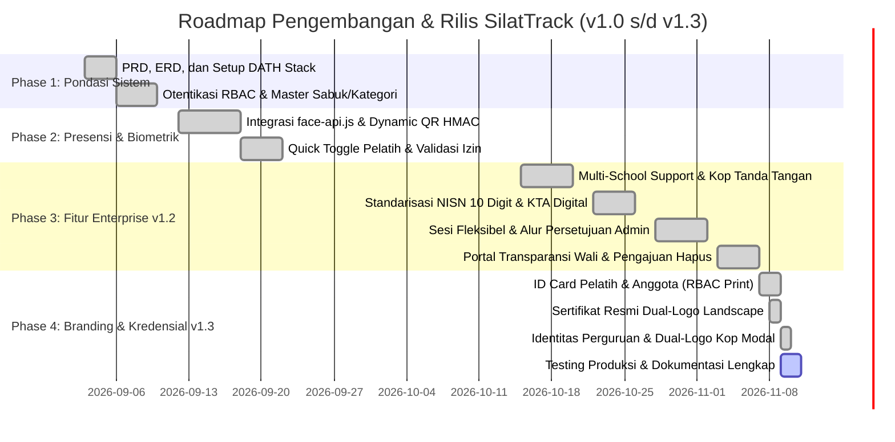

# Product Requirements Document (PRD)
## Aplikasi Absensi Ekstrakurikuler Pencak Silat

- **Nama Produk**: **SilatTrack** (Sistem Absensi & Manajemen Eskul Pencak Silat Multi-Sekolah)
- **Tech Stack**: **DATH Stack** (Django 5.2 + Alpine.js 3 + Tailwind CSS + HTMX 2)
- **Arsitektur**: HTML-over-the-Wire / Modern Monolith
- **Design System**: Google Material Design 3 (M3)
- **Versi Dokumen**: 1.3.0 (Revisi Komprehensif: November 2026)
- **Status**: Production Deployment Ready

---

## 1. Executive Summary & Visi Produk

Ekstrakurikuler Pencak Silat di institusi pendidikan (SD/SMP/SMA/SMK) atau perguruan beladiri memiliki tantangan unik:
1. **Pencatatan Presensi Rentan Manipulasi**: Metode kertas rawan titip absen, basah saat latihan fisik, atau hilang saat pergantian kepengurusan.
2. **Kebutuhan Evaluasi Kenaikan Tingkat (UKT)**: Sulitnya menghitung persentase keaktifan siswa sebagai syarat mutlak kelayakan Ujian Kenaikan Tingkat sabuk.
3. **Pengelolaan Lintas Sekolah (Multi-School)**: Satu perguruan/pelatih sering kali mengampu ekstrakurikuler di beberapa sekolah mitra yang membutuhkan pemisahan data siswa, format kop surat, serta tanda tangan resmi kepala sekolah yang berbeda-beda.
4. **Transparansi kepada Pihak Sekolah & Orang Tua**: Kebutuhan pelaporan cepat untuk sinkronisasi nilai ekstrakurikuler e-Rapor dan pemantauan kehadiran oleh wali murid.

**SilatTrack** hadir sebagai solusi modern monolitik yang ringan, cepat, dan responsif (PWA-ready) berbasis **DATH Stack**. Aplikasi ini memanfaatkan paradigma **HTML-over-the-Wire** sehingga interaktif layaknya SPA (Single Page Application) tanpa kerumitan frontend build yang berat, dibungkus dalam estetika antarmuka **Google Material Design 3 (M3)** dengan warna khas Silat Crimson (`#8A1C14`) dan Brass Gold (`#7D5800`).

---

## 2. User Personas & Roles

| Role | Deskripsi | Kebutuhan Utama |
| :--- | :--- | :--- |
| **Super Admin / Pembina Eskul** | Guru Pembina atau Penanggung Jawab Ekstrakurikuler dari sekolah | Monitoring seluruh aktivitas, manajemen data master sekolah (Kop Surat, Kepala Sekolah, NIP), persetujuan (*approval*) usulan jadwal dan sesi latihan pelatih, verifikasi permohonan hapus anggota, audit log foto presensi biometrik, serta ekspor rekapitulasi nilai dan kehadiran resmi (PDF Cetak & Excel). |
| **Pelatih / Coach (Instruktur)** | Pelatih resmi perguruan silat yang bertugas di lapangan | Membuka/menutup sesi latihan rutin maupun ad-hoc fleksibel, mengoperasikan AI Face Recognition Scanner di lapangan, menampilkan Dynamic QR Code, quick toggle status kehadiran anggota (Hadir/Izin/Sakit/Alpa), mengunggah foto dokumentasi kegiatan latihan, memvalidasi surat izin/sakit, mengajukan mutasi/penghapusan pesilat secara aman, dan mengisi evaluasi UKT. |
| **Anggota / Pesilat (Siswa)** | Murid peserta ekstrakurikuler pencak silat | Melakukan registrasi awal wajah (*face enrollment*), absensi mandiri via Face Recognition atau Scan QR, mengunduh Kartu Tanda Anggota (KTA) Digital, mengajukan izin/sakit beserta foto bukti surat, memantau *attendance streak* dan persentase kelayakan sabuk. |
| **Orang Tua / Wali Murid** *(Public Portal)* | Orang tua dari siswa peserta ekstrakurikuler | Mengakses **Portal Transparansi Wali Murid** secara langsung tanpa registrasi login yang rumit (cukup memasukkan 10 digit NISN dan Tanggal Lahir siswa) untuk memantau keaktifan, kehadiran real-time, dan perkembangan sabuk anak. |

---

## 3. Core Features & Functional Requirements

### 3.1 Manajemen Multi-Sekolah & Konfigurasi Tanda Tangan Kustom (*Multi-School Support*)
- **Multi-Tenant Data Management**: Sistem mendukung pencatatan beberapa sekolah mitra sekaligus (`Sekolah`: nama sekolah, NPSN resmi, alamat lengkap, status aktif).
- **Customizable Official Signatures**: Setiap sekolah memiliki konfigurasi nama kepala sekolah, NIP resmi, dan jabatan penandatangan yang dinamis.
- **Filter Pelaporan per Sekolah**: Halaman rekapitulasi dan cetak laporan presensi dapat difilter berdasarkan sekolah tertentu. Format cetak PDF/Print otomatis menyusun kop surat resmi dan tanda tangan kepala sekolah serta pelatih bersangkutan.

### 3.2 Standarisasi NISN 10 Digit & Kartu Tanda Anggota (KTA) Digital
- **Standarisasi Kemdikbudristek**: Validasi format NISN tepat 10 digit angka (`^\d{10}$`) untuk menjamin keselarasan dengan DAPODIK dan sistem e-Rapor sekolah.
- **Kartu Tanda Anggota (KTA) Digital**: Pembuatan KTA digital interaktif dilengkapi foto profil, kode batang (barcode) / QR ID pesilat, informasi tingkat sabuk, dan nama sekolah yang siap diunduh atau dicetak.

### 3.3 Manajemen Jadwal & Sesi Latihan Fleksibel dengan Approval Workflow
- **Jadwal Rutin dengan Persetujuan**: Pelatih dapat mengusulkan jadwal latihan rutin baru yang ditinjau dan disetujui oleh Admin/Pembina sekolah.
- **Sesi Latihan Fleksibel / Ad-Hoc**: Pelatih dapat membuat sesi latihan di luar jadwal reguler (misal: Training Camp/TC kejuaraan, persiapan UKT, latihan fisik tambahan) dengan input lokasi mandiri (`nama_lokasi`), jam mulai, dan jam selesai.
- **Approval Workflow Sesi**: Sesi latihan memiliki siklus persetujuan status (`MENUNGGU`, `DISETUJUI`, `DITOLAK`) beserta catatan arahan dari admin pembina.
- **Dokumentasi Kegiatan Latihan**: Pelatih dapat mengunggah foto dokumentasi latihan harian (`foto_kegiatan`) dan keterangan dokumentasi untuk laporan pertanggungjawaban kegiatan.

### 3.4 Multi-Method Attendance dengan AI Biometric Face Recognition
1. **AI Face Recognition Scanner (Metode Utama)**:
   - Pemindaian wajah biometrik langsung di peramban menggunakan *face-api.js* (TinyFaceDetector, FaceLandmark68, FaceRecognitionNet).
   - Seluruh model neural network disajikan secara mandiri dan offline dari direktori server lokal (`/static/models/`).
   - Ekstraksi vektor *descriptor* 128 dimensi dengan pencocokan jarak Euclidean (*Euclidean distance* $\le 0{,}60$).
   - **Audit Trail & Anti-Fraud**: Setiap verifikasi wajah yang berhasil otomatis menyimpan foto snapshot kamera (`foto_face_scan`) dan nilai jarak kecocokan (`face_distance`) untuk diaudit oleh admin/pelatih.
2. **Dynamic Rolling QR Code (Metode Alternatif Cepat)**:
   - Layar QR Code berputar dinamis dengan token bertanda tangan HMAC-SHA256 yang berganti berkala untuk mencegah kecurangan titip absen via tangkapan layar.
3. **Pencatatan Cepat Manual (Quick Toggle Pelatih)**:
   - Antarmuka pelatih berbasis HTMX untuk mengubah status kehadiran siswa (Hadir, Izin, Sakit, Alpa) secara instan tanpa memuat ulang halaman (*zero page reload*).
4. **Pengajuan Izin & Sakit**:
   - Siswa dapat mengunggah bukti surat izin dari orang tua atau surat keterangan dokter. Pelatih memvalidasi surat tersebut secara langsung di antarmuka web.

### 3.5 Mekanisme Pengajuan Hapus Anggota Aman (*Safe Deletion Approval*)
- **Perlindungan Integritas Data**: Pelatih tidak dapat menghapus data pesilat secara sepihak untuk menjaga keutuhan riwayat kehadiran dan catatan sabuk.
- **Alur Pengajuan**: Pelatih mengisi formulir pengajuan mutasi/hapus anggota beserta alasan terinci.
- **Eksekusi Admin**: Admin meninjau permohonan, memberikan catatan evaluasi, dan memutuskan apakah pengajuan disetujui (*DISETUJUI*) atau ditolak (*DITOLAK*).

### 3.6 Portal Transparansi Wali Murid (*Parent Portal*)
- **Akses Publik Tanpa Login Rumit**: Wali murid dapat mengakses halaman transparansi publik tanpa perlu menghafal kata sandi.
- **Autentikasi Ganda Aman**: Menggunakan kombinasi 10 digit NISN anak dan Tanggal Lahir untuk memverifikasi hak akses.
- **Informasi Transparan**: Menampilkan persentase kehadiran, rekor latihan (*attendance streak*), tingkatan sabuk saat ini, dan rincian keikutsertaan sesi latihan terakhir.

### 3.7 Gamifikasi, Pelacakan Sabuk & Prasyarat UKT
- **Attendance Streak**: Penghitungan otomatis rekor sesi latihan berturut-turut tanpa alpa untuk mendorong kedisiplinan pesilat.
- **Kalkulator Kelayakan UKT**: Sistem menghitung otomatis persentase kehadiran terhadap ambang batas minimal sabuk (default $75\% - 80\%$) dan memberikan penanda kelayakan ujian.
- **Riwayat Kenaikan Sabuk**: Pencatatan riwayat ujian, penguji pelatih, predikat kelulusan (*Lulus Terpuji, Lulus, Mengulang*), dan evaluasi teknik.

### 3.8 Pelaporan & Rekapitulasi Eksekutif
- **Interactive Dashboard**: Statistik kehadiran per sesi, rata-rata bulanan, serta visualisasi grafik.
- **Ekspor Dokumen**:
  - File Excel (.xlsx) untuk pembukuan data.
  - Cetak Laporan PDF/Print resmi yang memuat kop surat sekolah, rekapitulasi presensi, dan tanda tangan kepala sekolah serta pelatih.

### 3.9 ID Card Digital Anggota & Pelatih Berbasis RBAC (Role-Based Access Control)
- **ID Card Dua Sisi Standar Profesional**: Menghasilkan kartu tanda pengenal berukuran standar ID Card CR80 dengan orientasi vertikal dan horizontal (sisi depan: foto, nama, peran, NISN/No. Registrasi, sekolah, sabuk/spesialisasi; sisi belakang: QR Code verifikasi, ketentuan tata tertib latihan, dan stempel perguruan).
- **Pembatasan Hak Akses Cetak (RBAC)**:
  - **Anggota / Pesilat**: Hanya memiliki hak akses melihat (*view-only*) ID Card digital mereka sendiri untuk keperluan pengenalan diri. Tombol cetak (*Print Card*) disembunyikan/dibatasi secara ketat.
  - **Admin & Pelatih**: Memiliki hak istimewa penuh (*full privilege*) untuk melihat, mengunduh, dan mencetak ID Card anggota maupun pelatih secara mandiri atau massal.

### 3.10 Sertifikat Penghargaan / Prestasi Resmi Pelatih & Anggota
- **Sertifikat Berstandar Resmi**: Penerbitan piagam sertifikat resmi penghargaan, kompetensi, atau apresiasi keaktifan eskul pencak silat untuk Anggota maupun Pelatih.
- **Dual-Logo Header**: Sertifikat memuat Logo Resmi Sekolah mitra di sebelah kiri dan Logo Resmi Perguruan Silat di sebelah kanan dengan ornamen bingkai klasik (*Golden-Crimson Border*).
- **Data Dinamis & Keabsahan Dokumen**: Mencantumkan nomor registrasi sertifikat unik, predikat/gelar pesilat atau kualifikasi pelatih, tanda tangan Kepala Sekolah, dan tanda tangan Pelatih Utama / Dewan Pendekar.
- **Print Optimization**: Tata letak siap cetak format Landscape A4 beresolusi tinggi tanpa elemen antarmuka web melalui instruksi `@media print`.

### 3.11 Identitas Perguruan Silat Global & Dual-Logo Kop Surat pada Laporan
- **Model Perguruan Tunggal (`Perguruan`)**: Menyimpan konfigurasi nama padepokan/perguruan, singkatan brand aplikasi (`singkatan`), semboyan, alamat dewan pusat, kontak, dan lambang resmi perguruan (`logo_perguruan`).
- **Global Context Processor**: Menyediakan variabel `perguruan_info` ke seluruh template sistem (bilah navigasi navbar, tab browser, halaman login, kop laporan, dan sertifikat).
- **Dual-Logo Kop Surat Laporan Presensi**: Kop surat laporan cetak otomatis menempatkan Logo Sekolah mitra di sisi kiri, identitas dinamis sekolah di bagian tengah, dan Logo Perguruan Silat di sisi kanan.
- **Modal Kustomisasi Logo Langsung**: Pada antarmuka cetak laporan, Admin dan Pelatih dapat menguji atau mengganti logo sekolah maupun perguruan secara seketika (*instant client-side preview*) melalui FileReader atau URL eksternal, dengan tombol opsional untuk menyimpan perubahan tersebut langsung ke basis data server.

---

## 4. Non-Functional Requirements (NFR)

| Kategori | Kriteria & Spesifikasi |
| :--- | :--- |
| **Kinerja & Responsivitas** | Response time server $< 200\text{ ms}$ untuk HTMX payload. Bobot fragmen DOM $< 5\text{ KB}$ per interaksi. Inferensi model wajah di browser klien $< 100\text{ ms}$ per frame. |
| **Kemandirian Offline AI** | Seluruh bobot model neural network (*weights manifest & shard bins*) dimuat dari direktori lokal server (`/static/models/`), tanpa ketergantungan API pihak ketiga. |
| **Keamanan & Integritas** | CSRF protection pada semua transmisi HTTP POST via HTMX, enkripsi password PBKDF2 SHA-256, token HMAC untuk Dynamic QR, dan validasi ganda Euclidean distance di sisi server (*Zero Client Trust*). |
| **Desain Responsif (M3)** | Desain *mobile-first* yang nyaman digunakan pada layar smartphone (360px - 430px) hingga laptop/desktop. Standar kontras rasio warna minimal $4{,}5:1$ (WCAG 2.1 AA). |
| **Integritas Arsip Historis** | Relasi kunci asing `on_delete=PROTECT` pada sesi yang memiliki riwayat presensi, serta audit trail foto biometrik untuk mencegah penyangkalan kehadiran (*non-repudiation*). |

---

## 5. UI/UX Design System: Google Material Design 3 (M3)

- **Color Roles & Dynamic Theming**:
  - *Primary*: Silat Crimson (`#8A1C14`) merepresentasikan keberanian, tradisi, dan energi beladiri pencak silat.
  - *Secondary / Accent*: Warm Brass Gold (`#7D5800`) melambangkan kehormatan, integritas, dan sportivitas pendekar.
  - *Surfaces*: Surface Container Lowest (`#FFFFFF`), Surface Low (`#FFF8F6`), Surface High (`#ECE6F0`).
- **Komponen M3 Utama**:
  - **Top App Bar**: Header terstruktur dengan lambang eskul, judul kontekstual, dan avatar status peran.
  - **Navigation Bar (Mobile)**: 4 tombol navigasi utama berbentuk pil di bagian bawah layar.
  - **Navigation Rail (Desktop)**: Sidebar vertikal responsif pada perangkat berlayar lebar.
  - **Scanner Reticle**: Visual pemindai wajah interaktif dengan perubahan warna otomatis (Abu-abu: Standby $\rightarrow$ Kuning: Stabilizing $\rightarrow$ Hijau: Verified).
  - **Badges, Chips & Snackbars**: Label status dinamis (Hadir, Izin, Sakit, Alpa) dan feedback aksi cepat dengan opsi *Undo*.

---

## 6. Release Phases & Roadmap

